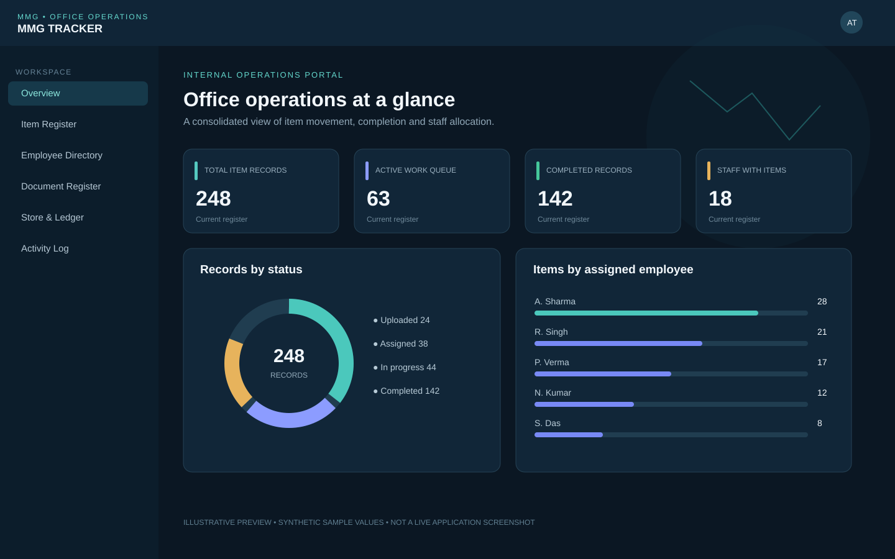
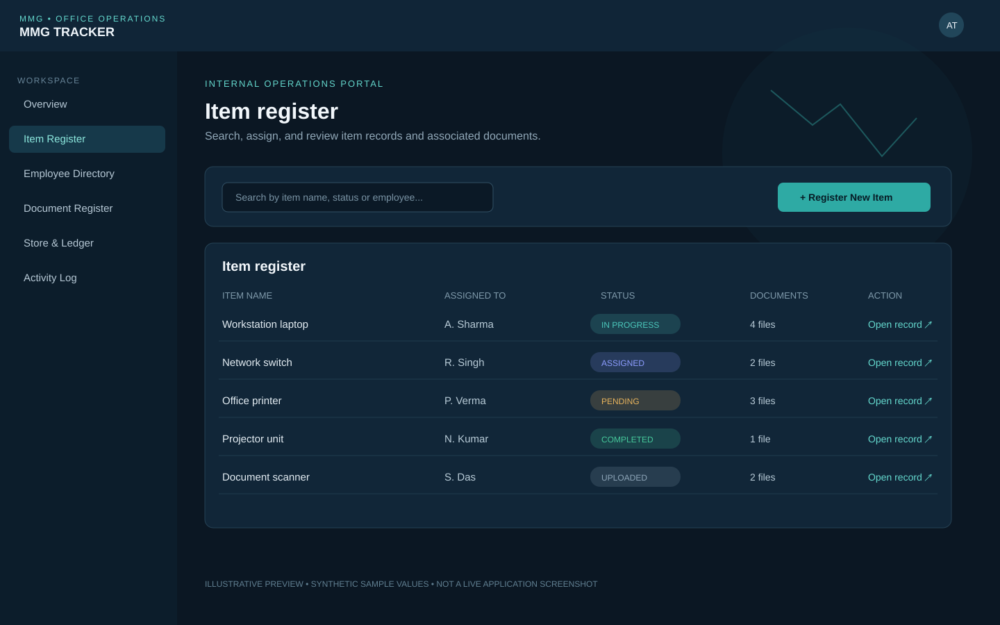
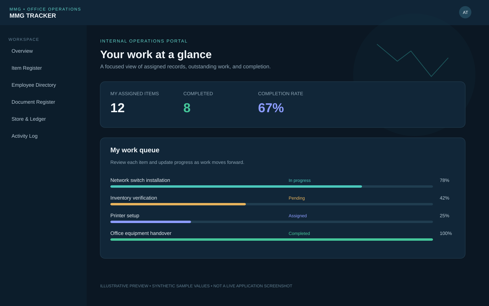

# MMG Tracker

A role-based internal operations portal for tracking office items, assigning work to employees, managing item documents, and maintaining a Store ledger. The interface uses an institutional government-office layout with responsive navigation, operational analytics, readable dashboards, and an animated India map background.

**Suggested GitHub repository description:** Role-based office item tracking and store management portal built with Spring Boot, React, Vite, MySQL, and JWT authentication.

## Screenshots / previews

The images below are **illustrative interface previews** made for this README. They show the intended layout and feature areas; they are not captures of a running instance or real office data.

### Operations dashboard


### Item register and document management


### Employee work queue


The live UI also includes the animated India map background. For accurate screenshots of your local build, start the app and capture the browser at `http://localhost:5173`.

## Features

- Role-based access: `JS_ADMIN`, `DIRECTOR_ADMIN`, `ADMIN`, `EMPLOYEE`, `OIC_STORE`, and `BILLING`.
- **Existing account continuity:** this repository does not replace or reset the existing superadmin/admin/employee accounts or passwords. Accounts are stored in MySQL. Back up your database before running the application against it.
- Item registration, assignment, status updates, and item history.
- Multiple files per item, with per-file remarks and uploader/editor metadata; view/download, edit remarks, and replace documents according to permissions.
- Operational analytics: status distribution, item totals, active work queue, completion progress, and employee allocation based on accessible records.
- Store module for demands, category fields, ledger, and stock workflows.
- Responsive government-office style navigation, readable typography, charts, and animated India map background.
- JWT authentication and BCrypt password hashing.

## Technology stack

| Layer | Technology |
|---|---|
| Backend | Java 17, Spring Boot 3.3.5, Spring Security, Spring Data JPA |
| Frontend | React 18, Vite 5, React Router, Axios, Lucide icons |
| Database | MySQL 8+ recommended |
| Authentication | JWT and BCrypt |
| File storage | Local `uploads/` directory |

## Requirements

- Git
- Java JDK 17
- Node.js 20 LTS or later and npm
- MySQL Server 8+ and a database client
- Internet access for the first Maven Wrapper run if Maven is not already cached

You do not need to install Maven globally. This project includes `mvnw` and `mvnw.cmd`.

## Install and run on Windows

### 1. Clone the repository

Replace `YOUR_GITHUB_USERNAME` with the account that owns your repository:

```powershell
git clone https://github.com/YOUR_GITHUB_USERNAME/mmg-tracker.git
cd mmg-tracker
```

If using a ZIP, extract it and open a terminal in the extracted project root.

### 2. Create or connect to MySQL

Start MySQL and run:

```sql
CREATE DATABASE mmg_tracker CHARACTER SET utf8mb4 COLLATE utf8mb4_unicode_ci;
```

If you already have the database that contains your current superadmin, admin, and employee accounts, **do not replace it or delete it**. Back it up first and configure the app to connect to that existing database. Hibernate is configured to update mapped tables at startup. Review `src/main/java/com/example/mmg/config/RoleInitializer.java` before using the app with important data; it contains compatibility logic for legacy role names.

### 3. Configure backend environment variables

In the same PowerShell terminal that will run the backend:

```powershell
$env:DB_URL = "jdbc:mysql://localhost:3306/mmg_tracker?allowPublicKeyRetrieval=true&useSSL=false"
$env:DB_USERNAME = "root"
$env:DB_PASSWORD = "YOUR_LOCAL_MYSQL_PASSWORD"
$env:JWT_SECRET = "REPLACE_WITH_A_LONG_RANDOM_SECRET_AT_LEAST_32_CHARACTERS"
```

Replace the sample values with your local database password and a long random JWT secret. Do not commit credentials or share them in screenshots. These variables apply only to the current terminal session, so set them again if you open another terminal.

For production, use a secret manager or protected environment configuration, a unique high-entropy JWT secret, TLS, and secure database credentials. The built-in JWT fallback is for local development only.

### 4. Start the backend

From the project root:

```powershell
.\mvnw.cmd clean spring-boot:run
```

On macOS/Linux:

```bash
chmod +x ./mvnw
./mvnw clean spring-boot:run
```

The API runs at `http://localhost:8081`. Keep this terminal open. The first run may download Maven and Java dependencies.

### 5. Start the frontend

Open a second terminal:

```powershell
cd mmg-frontend
npm install
npm run dev
```

Open the local URL Vite prints, normally `http://localhost:5173`. The frontend API client currently uses `http://localhost:8081/api`.

To create a production frontend bundle:

```bash
npm run build
```

The bundle is created in `mmg-frontend/dist/`.

## Login and existing accounts

- Use the **existing** superadmin, admin, and employee usernames/passwords from your current database.
- This repository does not publish or assume any default credentials, and it does not seed sample login users automatically.
- On a fresh database, create the initial authorised accounts using your approved account-creation process.
- The role initializer can map the legacy `SUPER_ADMIN` role to `JS_ADMIN`; it does not reset that user's password. Back up the database before startup.

## Role overview

| Role | Intended access summary |
|---|---|
| `JS_ADMIN` | Executive administration and broad oversight |
| `DIRECTOR_ADMIN` | Executive administration and broad oversight |
| `ADMIN` | Team/item administration within permitted scope |
| `EMPLOYEE` | Assigned work, status updates, and permitted documents |
| `OIC_STORE` | Store oversight and correction workflow |
| `BILLING` | Store billing and ledger updates within permitted scope |

The backend enforces permissions through Spring Security and controller/service checks. Hiding a button in the frontend is not the security boundary.

## Multiple-file item documents

- Multiple attachments can be associated with one item.
- Each attachment supports its own remarks and uploader/editor metadata.
- Document actions are checked by the backend against the user's role and item access.
- The configured limit is 20 MB per file and 100 MB per multipart request.
- Files are stored under `uploads/`. This directory is intentionally excluded from Git because it can contain private office documents or personal information.

Back up `uploads/` separately if you need to preserve real attachments. Never commit private office documents to a public repository.

## Store and migration notes

See [`STORE_REBUILD.md`](STORE_REBUILD.md), [`STORE_REBUILD_MIGRATION.sql`](STORE_REBUILD_MIGRATION.sql), and [`ITEM_DOCUMENT_REGISTER.md`](ITEM_DOCUMENT_REGISTER.md) for additional details. Take a verified database backup before running migrations on an existing installation.

## Troubleshooting

**`mvn` is not recognized:** use the included wrapper from the project root: `\.\mvnw.cmd clean spring-boot:run`.

**`vite` is not recognized:** run `npm install` from inside `mmg-frontend`, then `npm run dev`.

**MySQL connection/access denied:** verify MySQL is running, the database exists, and `DB_URL`, `DB_USERNAME`, and `DB_PASSWORD` are set in the same terminal that starts Spring Boot.

**Port is in use:** stop the process using port `8081` or `5173`. If changing the backend port, also update the frontend API base URL in `mmg-frontend/src/api/client.js`.

**Login fails after switching databases:** accounts belong to the database, not the ZIP. Ensure you connected to the database that contains your existing users. Do not reset or recreate accounts before backing up the database.

## Before pushing to GitHub

- Confirm the ignore file is named exactly `.gitignore`.
- Ensure `uploads/` contains no real documents to be committed.
- Never commit database passwords, JWT secrets, `.env` files, user exports, or production data.
- Review `git status` and staged files before the first push.
- If a secret was ever committed, rotate it. Removing it from the latest version does not remove it from Git history.


## Publish this project to GitHub

1. Sign in to GitHub and choose **New repository**.
2. Name it `mmg-tracker`. Choose **Private** unless you have permission to publish this internal-office project publicly.
3. For the first push, leave **Add a README**, **.gitignore**, and **License** unchecked because this project already contains its own files.
4. Open PowerShell in the project root and run:

   ```powershell
   git init
   git add .
   git status
   git commit -m "Initial MMG Tracker release"
   git branch -M main
   git remote add origin https://github.com/YOUR_GITHUB_USERNAME/mmg-tracker.git
   git push -u origin main
   ```

5. Replace `YOUR_GITHUB_USERNAME` with your GitHub username. Complete GitHub's browser/device authentication prompt if requested.
6. Refresh the GitHub repository page. The README and preview images should appear on the repository home page.

Before running `git add .`, review `git status`. If `origin` already exists, use `git remote -v` and update it with `git remote set-url origin https://github.com/YOUR_GITHUB_USERNAME/mmg-tracker.git` instead of adding a second remote. If the GitHub repository already contains commits, do not force-push; fetch and reconcile the remote history first.

## License

No license is granted unless one is added explicitly. Keep this repository private unless you have approval to publish the source and documentation.
